# cert-lint

A certificate inventory is the first step of every TLS cleanup and every post-quantum migration. cert-lint reads PEM files and tells you which certificates are expired or about to be, which use weak keys or SHA-1 signatures, which have no Subject Alternative Name, and which still rely on RSA or elliptic curves that a quantum computer would break.



**Live demo:** https://jvch0512.github.io/cert-lint/ (Synthetic certificates for example.test hosts, evaluated at 2026-11-14.)

Erlang/OTP, standard library only (uses OTP's public_key). The demo page is rendered from the tool's `--tsv` output by `scripts/site.py` (Python 3, only needed to regenerate the page).

## Use

```bash
make build
./bin/cert-lint examples/certs
./bin/cert-lint site-bundle.pem --today 2026-12-01
./bin/cert-lint /etc/ssl/mycerts --fail-on high      # exit 1 in CI
```

Point it at a PEM file (bundles with several certificates are fine) or a directory of `.pem`, `.crt` and `.cer` files. `--tsv` prints machine-readable output and `--today YYYY-MM-DD` makes reports reproducible.

| Rule | Severity | What it catches |
|---|---|---|
| CERT001 | critical, high, medium | expired, or expiring within 14 and 30 days |
| CERT002 | critical, high | RSA keys under 1024 bits, under 2048 bits |
| CERT003 | high | MD5 or SHA-1 signatures |
| CERT005 | high | no Subject Alternative Name (modern clients ignore the CN) |
| CERT004 | medium | leaf validity above 398 days |
| CERT007 | low | RSA or elliptic-curve keys: not quantum-safe, plan the migration |
| CERT008 | low | wildcard certificates |

See [examples](examples) and [docs/sample-output.txt](docs/sample-output.txt).

## Limits

- It reads certificates, not the live handshake: it cannot see what a server actually serves or the chain it sends.
- Revocation (CRL and OCSP) and Certificate Transparency are not checked.
- The 398-day rule applies to publicly trusted leaf certificates. Private PKI may legitimately differ, so treat CERT004 as advice there.
- Only RSA and EC keys are interpreted. Other key types are reported as unknown.

## Where it fits

Certificate inventories for audits, TLS hygiene reviews, expiry monitoring in CI, and the cryptographic inventory step of a post-quantum migration (it pairs with [pqc-readiness](https://github.com/jvch0512/pqc-readiness)).

## Tests

```bash
make test    # EUnit tests, 20+ cases
```

MIT.

## Code scanning (SARIF)

`scripts/tsv2sarif.py` converts the `--tsv` output into SARIF 2.1.0, so findings show up in GitHub code scanning:

```sh
./bin/cert-lint examples/certs --today 2026-11-14 --tsv | python3 scripts/tsv2sarif.py --tool cert-lint --prefix examples/certs > results.sarif
```

Upload `results.sarif` with `github/codeql-action/upload-sarif`. Severities map to SARIF levels (critical and high to error, medium to warning, low and info to note) and to a `security-severity` score.
